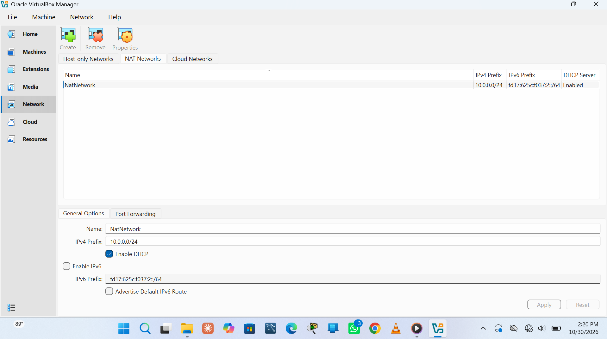
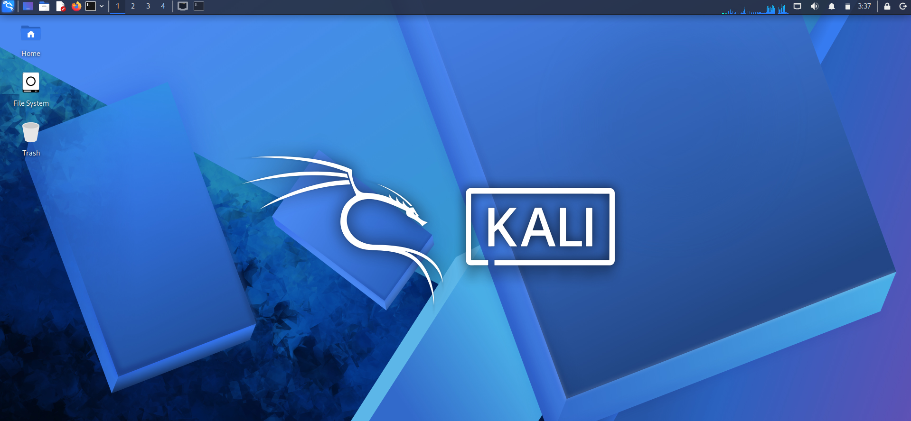
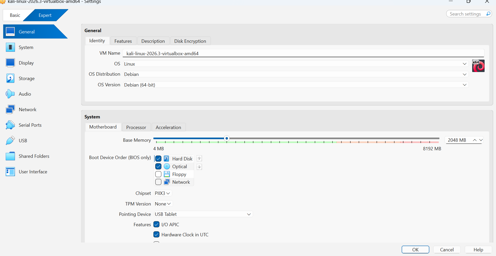
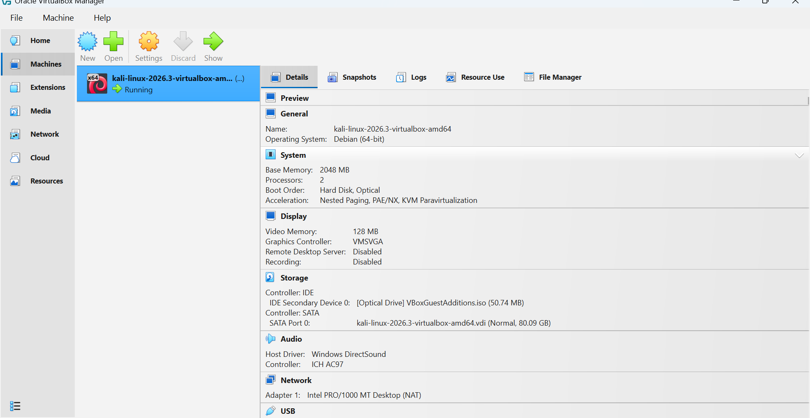
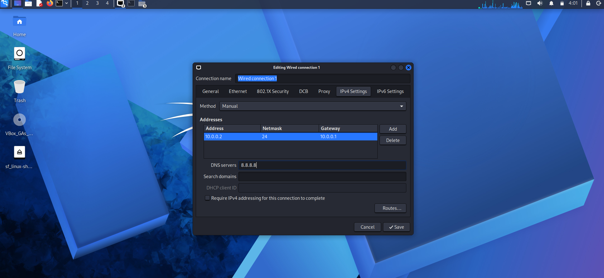
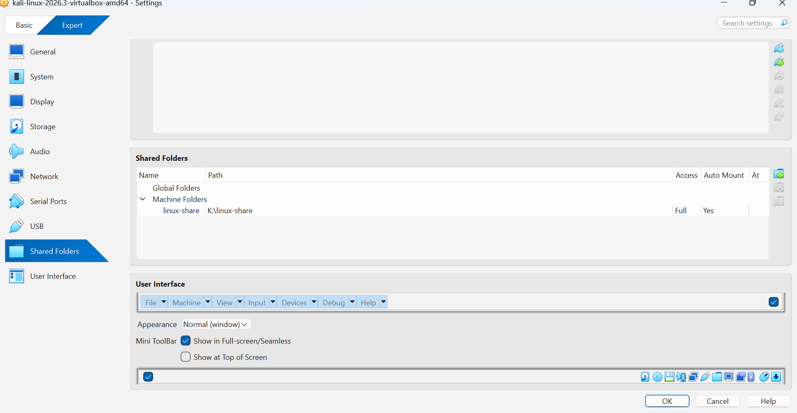

# Cybersecurity Lab Setup: VirtualBox + Kali Linux

An isolated virtual lab for learning penetration testing and ethical hacking, built on VirtualBox with a private NAT network and a Kali Linux attacker machine.

## Objectives

- Install VirtualBox on a Windows host.
- Import Kali Linux as a virtual machine.
- Create a private NAT Network on the `10.0.0.0/24` subnet.
- Give the Kali VM a fixed IP address (`10.0.0.2/24`) with Internet access.
- Share a folder between the host and the VM.

## Lab Design

| Item | Value |
|------|-------|
| Hypervisor | Oracle VirtualBox |
| Attacker VM | Kali Linux 2026.3 (amd64) |
| Network | NAT Network `NatNetwork`, subnet `10.0.0.0/24` |
| Gateway | `10.0.0.1` |
| Kali IP (manual) | `10.0.0.2/24` |
| DNS | `8.8.8.8` |

The same NAT Network can later host other machines (for example Windows or Android VMs) as targets, so all of them can reach each other while staying separate from the home network.

## Setup Steps

### 1. Create the NAT Network

In VirtualBox Manager, open **Tools > Network > NAT Networks** and create a network named `NatNetwork` with the IPv4 prefix `10.0.0.0/24`. DHCP stays enabled and IPv6 is left off.



### 2. Import Kali Linux

The prebuilt Kali VirtualBox image was downloaded from the official Kali website and imported into VirtualBox.



The VM is a Debian (64-bit) guest with 2048 MB of base memory and 2 processors.





### 3. Configure a static IP on Kali

On Kali, open the network menu, choose **Edit Connections**, select **Wired connection 1**, and open the **IPv4 Settings** tab:

- Method: **Manual**
- Address: `10.0.0.2`, Netmask: `24`, Gateway: `10.0.0.1`
- DNS servers: `8.8.8.8`



### 4. Shared folder

A folder on the host (`K:\linux-share`) is shared with the VM under the name `linux-share`, with full access and auto-mount enabled. The VirtualBox Guest Additions are installed, and the shared folder shows up on the Kali desktop as `sf_linux-share`.



## Troubleshooting Notes

If the Kali VM has no Internet on newer VirtualBox 7 and Kali versions, these checks help:

- Make sure the NAT Network exists with the right prefix and that the VM adapter is attached to it (**Settings > Network > Attached to: NAT Network**).
- Make sure no other VM on the same NAT Network uses `10.0.0.2`.
- Try `10.0.0.1` as the DNS server instead of `8.8.8.8`.
- Disable duplicate address detection and reconnect:

```bash
sudo nmcli connection modify "Wired connection 1" ipv4.dad-timeout 0
sudo nmcli connection down "Wired connection 1"
sudo nmcli connection up "Wired connection 1"
```

## My Experience

The biggest problem I had during this lab was that the Kali VM had no Internet access.i try to enhance 
and make no other VM on the same network uses 10.0.0.2.

## Credits

This project follows the Week 1 lab task from the NetworkWalks cybersecurity course. The screenshots are from my own lab.

## Author

**Khamis Mussa Khamis**
GitHub: [Silent-Man05](https://github.com/Silent-Man05)
